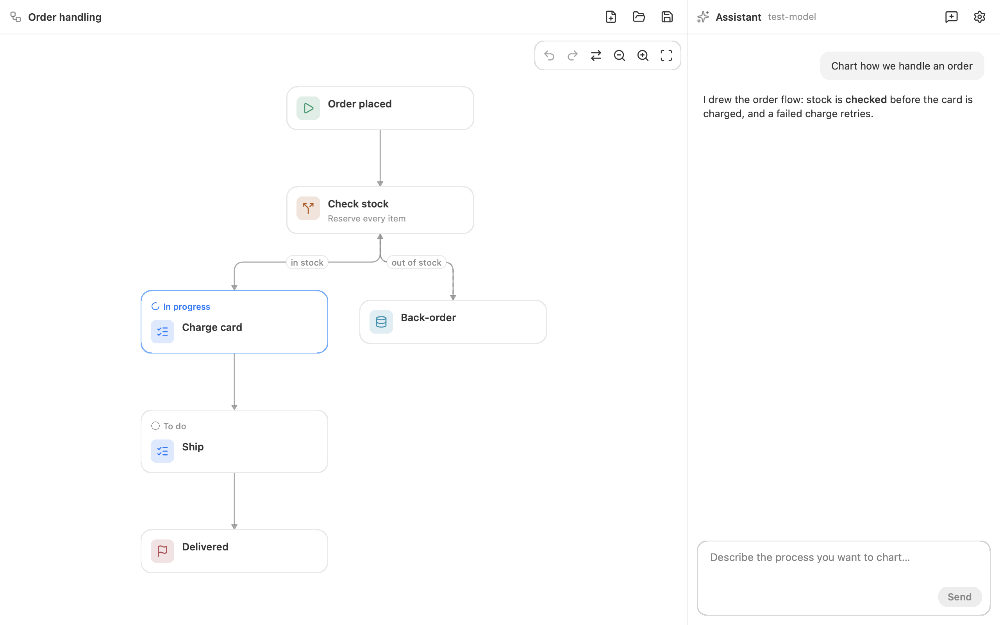

<p align="center">
  
</p>

<h1 align="center">Flow Editor</h1>

<p align="center">
  <strong>English</strong> |
  <a href="README.zh-CN.md">简体中文</a>
</p>

<p align="center">
  <a href="https://github.com/oneo-me"></a>
  <a href="https://oneo.me"></a>
  <a href="https://x.com/oneo666"></a>
  <a href="https://github.com/sponsors/oneo-me"></a>
</p>

<p align="center">
  A desktop app and flow designer where you design an app's screens and flow charts by talking with an AI assistant that draws them as you agree.
</p>

<p align="center">
  
</p>

## Features

- Screens listed on the left, the open screen in the middle with a tab for its design and one for each flow chart, conversation on the right.
- Designs for phone, tablet or desktop are drawn with real NSGo controls — buttons, fields, switches, tabs, stats, charts, sidebars and more — and can be tried.
- The assistant asks what it needs, then lays out interfaces and adds, links and rearranges nodes with tools.
- Attach a project folder, and the assistant reads its code to chart how it works.
- Each assistant change undoes as one step.
- Works with any OpenAI-compatible provider that supports tool calls, local servers included.
- Designs are plain-text `.flow` files you can read, diff and edit by hand.
- Runs on macOS, Windows and Linux, in English and Simplified Chinese.

## Run

Flow Editor needs [Go](https://go.dev/dl/). From the repository root:

```sh
go tool nsgo dev            # run
go tool nsgo build          # build macOS, Windows and Linux into dist/
```

On macOS, `.flow` files open with the app from the Finder; on Windows and Linux, a flow file given on the command line opens at start.

## Getting started

1. Open **Settings** (⌘,) and enter a provider's base URL, such as `https://api.openai.com/v1`, an API key and a model that supports tool calls.
2. Describe an app or a process in the assistant, such as "Design the sign-in screen of a coffee shop app" or "Chart how we handle an order".
3. To chart an existing project, press **Attach project folder** above the message box and pick its folder.
4. Answer its questions and watch it draw the screens and flows on the left; pick a screen on the left and switch between its design and flows with the tabs.
5. Save the design as a `.flow` file, or open `examples/shop.flow` or `examples/order.flow` to start from an example.

The [`flowfile` package comment](flowfile/) describes the file format.

## Usage statistics

Release builds send anonymous usage statistics to Umami: how often and how long the app is used, under a random install ID. No chart, message, file path or API key is sent. Turn them off under **Settings** → **Statistics**. Builds of `nsgo dev` and tests send nothing.

## Development

From the repository root:

```sh
go tool nsgo check          # vet, catalogs and generated files
go tool nsgo test           # tests, headless against a fake model
```

Read [ARCHITECTURE.md](ARCHITECTURE.md) for the design and [AGENTS.md](AGENTS.md) for the rules contributors follow.

See [CHANGELOG.md](CHANGELOG.md) for changes.

## License

Flow Editor is released under the [MIT License](LICENSE). Contributions are accepted under the same license.
