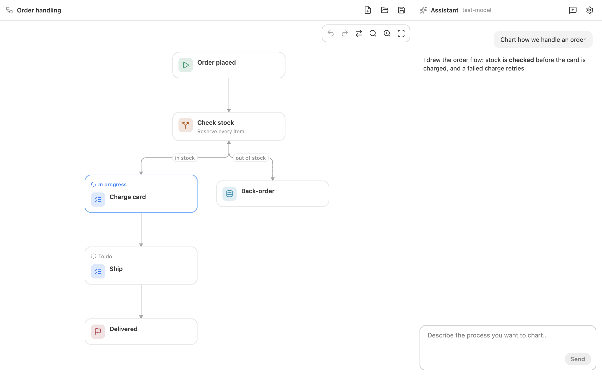

<p align="center">
  
</p>

<h1 align="center">Scenra</h1>

<p align="center">
  <strong>简体中文</strong> |
  <a href="README.md">English</a>
</p>

<p align="center">
  <a href="https://github.com/oneo-me"></a>
  <a href="https://oneo.me"></a>
  <a href="https://x.com/oneo666"></a>
  <a href="https://github.com/sponsors/oneo-me"></a>
</p>

<p align="center">
  一款桌面应用与流程设计工具：和 AI 助手对话来设计应用的界面和流程图，助手按商定的内容把它们画出来。
</p>

<p align="center">
  
</p>

## 名称由来

Scenra 是一个自造词：*scene*（场景）指构成应用的一个个界面，*-ra* 指从一个界面走向下一个界面的流程。一个 Scenra 文件里装的正是这两样：界面，以及它们之间的路径。

## 功能

- Scenra 文件以标签页的形式排在窗口顶部；左侧列出每个界面的设计和流程图，中间是打开的那个，右侧是贯穿窗口高度的对话。
- 文件会记住打开或保存时的路径，按 ⌘S 直接原地保存，下次启动时重新打开。
- 手机、平板和桌面设计由方块、文本、图标、图片和 SVG 组成，用 Tailwind CSS 类名塑造外观，草图可以画成任何样子；和流程图一样可以缩放、平移并选择其中的元素。
- 助手先问清需要的信息，再用工具绘制界面布局，并添加、连接和重排节点。
- 助手基于你选中的内容工作，处理你在设计元素上留下的评论，可以读取你打开的其他文件，并阅读文件所在文件夹中的代码，画出项目的工作流程。
- 助手的每次修改可作为一步撤销。
- 支持任何兼容 OpenAI 且支持工具调用的服务商，包括本地服务。
- 设计保存为纯文本 `.scenra` 文件，可直接阅读、对比和手动编辑。
- 运行于 macOS、Windows 和 Linux，支持英文和简体中文。

## 运行

Scenra 需要 [Go](https://go.dev/dl/)。在仓库根目录执行：

```sh
go tool nsgo dev            # run
go tool nsgo build          # build macOS, Windows and Linux into dist/
```

在 macOS 上，可以从访达用本应用打开 `.scenra` 文件；在 Windows 和 Linux 上，命令行中给出的 Scenra 文件会在启动时打开。

## 快速开始

1. 打开**设置**（⌘,），填写服务商的接口地址（如 `https://api.openai.com/v1`）、API 密钥和支持工具调用的模型。
2. 在助手中描述一个应用或流程，例如“设计一个咖啡店应用的登录界面”或“画出我们处理订单的流程”。
3. 要为现有项目画流程图，把 Scenra 文件保存在项目文件夹中：助手会阅读该文件夹。
4. 回答它的问题，看它画出界面和流程；在左侧选择某个界面的设计或流程。
5. 新建文件时先选择保存位置，之后按 ⌘S 保存；也可以打开 `examples/shop.scenra` 或 `examples/order.scenra` 从示例开始。

文件格式见 [`flowfile` 包注释](flowfile/)。

## 使用统计

正式构建会向 Umami 发送匿名使用统计：应用的使用次数和时长，附带一个随机的安装 ID。不会发送流程图、消息、文件路径或 API 密钥。可在**设置** → **统计**中关闭。`nsgo dev` 的构建和测试不发送任何统计。

## 开发

在仓库根目录执行：

```sh
go tool nsgo check          # vet, catalogs and generated files
go tool nsgo test           # tests, headless against a fake model
```

设计见 [ARCHITECTURE.md](ARCHITECTURE.md)，贡献规则见 [AGENTS.md](AGENTS.md)。

变更记录见 [CHANGELOG.md](CHANGELOG.md)。

## 许可证

Scenra 以 [MIT 许可证](LICENSE) 发布。贡献内容按同一许可证接受。
